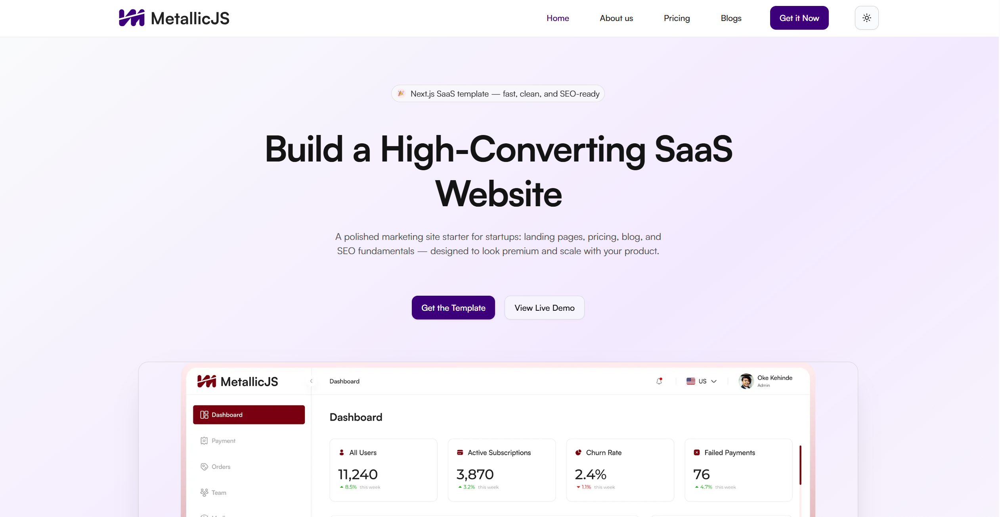
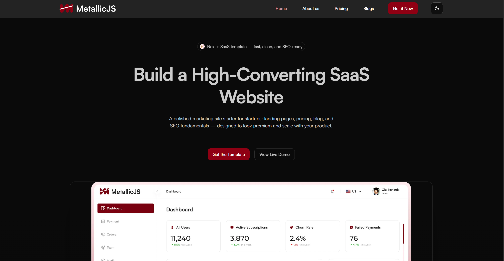

# Next.js SaaS Landing Page Template (free, SEO-ready)

A production-ready SaaS landing page built with **Next.js 16 (App Router)**, **Tailwind CSS v4**, **shadcn/ui** and **TypeScript**, with **SEO done properly**, a **professional UI design system**, and a **monorepo-friendly** structure baked in.

**[Live demo](https://nextjs-saas-landing-pag.vercel.app)** · [Fork it](https://github.com/okeken/nextjs-saas-landing/fork) · [Report a bug](https://github.com/okeken/nextjs-saas-landing/issues)

> If this repo saves you time, please ⭐️ **star it**. It helps other builders find it.

| Light | Dark |
| ----- | ---- |
|  |  |

---

## Quick start

Requirements: **Node.js 20+** and **pnpm** (run `corepack enable` if you don't have it).

**Option A: start your own copy.** Click **Use this template** (or [fork the repo](https://github.com/okeken/nextjs-saas-landing/fork)), then clone your new repo.

**Option B: clone this one.**

```bash
git clone https://github.com/okeken/nextjs-saas-landing.git
cd nextjs-saas-landing
pnpm install
pnpm dev
```

Open [http://localhost:3000](http://localhost:3000). No environment variables are needed to run it; see [Environment variables](#environment-variables) when you're ready to brand it.

---

## Features

### SEO-first architecture

* Every page has a title, description, canonical URL, Open Graph and Twitter card tags, built by one helper (`apps/web/lib/seo`)
* A generated share image for every page and blog post (`/api/og`)
* `robots.ts` and `sitemap.ts` out of the box, with correct absolute URLs on Vercel even before you set your domain
* JSON-LD structured data (Organization, WebSite, SoftwareApplication, pricing offers, blog posts)
* Google Search Console verification through one environment variable

### Next.js 16 ready

* Built and tested against Next.js 16 (App Router), React 19
* Uses the stable Metadata API, `robots.ts`, `sitemap.ts`, `next/og`

### Professional UI design system

* Radix UI primitives (accessibility-first)
* Tailwind CSS v4 with `class-variance-authority` and `tailwind-merge`
* Icons from Lucide
* Forms via React Hook Form + Zod
* Dark / light mode

### Monorepo-friendly

* Turborepo / pnpm workspace
* Shared UI package (`packages/ui`, imported as `@metallicjs/ui`) with Storybook
* Shared utilities, ESLint and TypeScript configs (`packages/shared`)

### DX & tooling

* TypeScript (strict), ESLint, Prettier, Husky, lint-staged, commitlint
* Storybook 9 (Vite), runs independently of Next.js
* Ready for Vitest/Playwright (add tests as needed)

---

## Included pages & sections

* Navbar, Hero, Features, Pricing, Testimonials, FAQ, CTA, Footer
* Pricing page with a plan comparison
* Blog (MDX) with post pages, related posts and share links
* About, Contact, Privacy Policy, Terms of Service

You can remove or replace sections freely; nothing is tightly coupled.

---

## Environment variables

All optional. Put them in `apps/web/.env.local` for local development (copy `apps/web/.env.example`), or in your host's settings (Vercel: Settings → Environment Variables, then redeploy).

| Variable | Used for | Default |
| --- | --- | --- |
| `NEXT_PUBLIC_SITE_URL` | Canonical URLs, sitemap, robots.txt, share images. No trailing slash. | Your Vercel production domain, or `http://localhost:3000` |
| `NEXT_PUBLIC_SITE_NAME` | Brand name in titles, share images and the footer | `MySaas` |
| `NEXT_PUBLIC_TAG_LINE` | Default description and share-image footer | `Production-ready marketing system` |
| `NEXT_PUBLIC_TWITTER_HANDLE` | `twitter:creator` tag | empty |
| `NEXT_PUBLIC_CURRENCY` | Currency in pricing structured data | `USD` |
| `GOOGLE_SITE_VERIFICATION` | Google Search Console "HTML tag" verification | not set |

The values are read in `apps/web/config/index.ts`, which defines the `SITE` constants used across the app.

---

## Deploy

On Vercel: import your repo, set **Root Directory** to `apps/web` (Vercel installs the whole pnpm workspace for you), and deploy. Add the environment variables above whenever you're ready.

### Get indexed by Google

1. In [Google Search Console](https://search.google.com/search-console), add your site as a **URL prefix** property and pick the **HTML tag** method.
2. Copy the tag's `content` value into `GOOGLE_SITE_VERIFICATION` and redeploy, then click **Verify**.
3. Submit `https://your-domain/sitemap.xml` under **Sitemaps**.

---

## Technical details

### Metadata

* `apps/web/lib/seo/index.ts`: `buildMetadata()` returns the title, description, canonical, Open Graph and Twitter tags for a page. Every page uses it.
* `apps/web/app/robots.ts`: blocks crawling outside production; in production it allows everything except `/api/` (but keeps `/api/og` open for link previews).
* `apps/web/app/sitemap.ts`: static routes plus MDX blog posts with accurate `lastModified`.

### Open Graph image generation

* Uses the built-in Next.js OG Image API (`next/og`) at `/api/og`
* Query params:
  * `title`: overrides the default title (clamped to 70 chars)
  * `subtitle`: optional secondary text (clamped to 120 chars)
  * `theme`: `dark` | `light` (defaults to `dark`)
* Example: `/api/og?title=Hello&subtitle=World&theme=light`
* Colours come from your design tokens: `pnpm gen:og` (run automatically by `pnpm dev`) reads `packages/ui` styles.

### Storybook (UI package)

```bash
cd packages/ui
pnpm storybook
```

Open [http://localhost:6006](http://localhost:6006).

---

## Project structure (simplified)

```text
apps/
  web/                # SaaS marketing site (Next.js App Router)

packages/
  ui/                 # design system, imported as @metallicjs/ui
    components/
    hooks/
    lib/
    styles/

  shared/             # shared utilities, ESLint + TypeScript configs
```

---

## Customisation

Common places you'll edit:

* `apps/web/app/(website)/page.tsx`: home page title and description (search results and link previews)
* `apps/web/app/(website)/(main)/one/`: landing page sections
* `apps/web/app/(website)/_components`: shared UI sections (Hero, Navbar, Footer, ...)
* `apps/web/config/index.ts`: site constants, and `TEMPLATE_LINKS`, where the demo's buttons point. Change these to your own sign-up or product links.
* `apps/web/public`: images, favicons
* `packages/ui`: shared components and styles

The footer shows a small "Built with" link to this repo. Keeping it is optional (and appreciated); delete `credit` in `apps/web/app/(website)/_components/Footer/data.ts` to remove it.

---

## Contributing

Issues and pull requests are welcome. If you spot something incorrect or missing, please open an issue or PR.

---

## License

MIT License © 2025 Kehinde Oke

If this template helped you ship, a ⭐️ helps others discover it.
